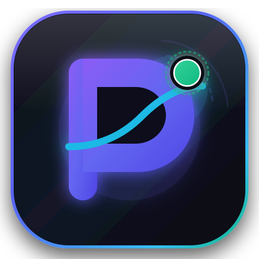
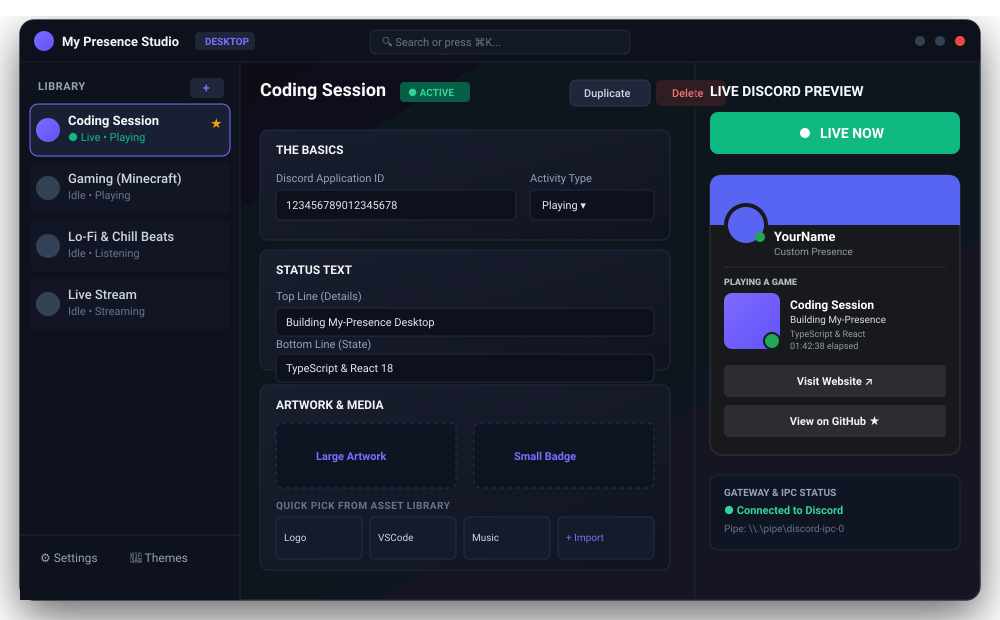
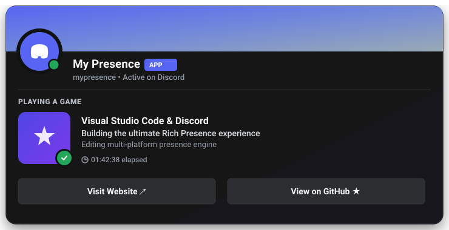
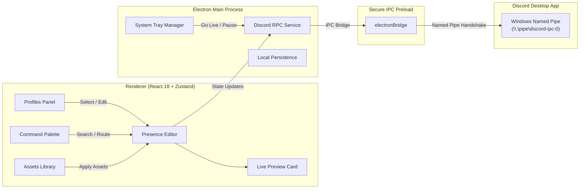

<div align="center">

  

  # My Presence (Desktop Studio)

  <p>
    <strong>Next-generation Discord Rich Presence Studio for Windows &amp; PC.</strong><br>
    <em>Jo Discord detect nahi karta, wo hum detect karwate hain!</em>
  </p>

  <p>
    <a href="https://react.dev/"></a>
    <a href="https://www.typescriptlang.org/"></a>
    <a href="https://www.electronjs.org/"></a>
    <a href="https://vitejs.dev/"></a>
    <a href="https://discord.com/developers/docs/topics/rpc"></a>
    
    
  </p>

  <p>
    <a href="#-the-core-difference">Why My Presence?</a> •
    <a href="#-quick-preview">Preview</a> •
    <a href="#-features">Features</a> •
    <a href="#-how-to-use-step-by-step">How to Use</a> •
    <a href="#%EF%B8%8F-keyboard-shortcuts">Shortcuts</a> •
    <a href="#%EF%B8%8F-architecture">Architecture</a> •
    <a href="#-build--development">Build &amp; Run</a> •
    <a href="#-troubleshooting">FAQ</a>
  </p>

</div>

---

> [!IMPORTANT]
> ### 💡 Why My Presence Desktop?
> Discord natively detects Spotify and a handful of verified mainstream games. But what about **custom coding projects, browser streams, non-Steam games, video editors, 3D modeling, emulators, or personal activities**?
> 
> **My Presence gives you 100% control.** Broadcast rich presence for *any* application, game, or custom hobby with your own custom Discord Application ID, high-resolution artwork, real-time elapsed timers, and interactive action buttons!

---

## 📸 Quick Preview

### Actual Application Studio & Live Discord Card Preview
<div align="center">
  
</div>

### What Your Friends See On Discord
<div align="center">
  
</div>

---

## ✨ Features

- 🎮 **Real-Time Discord Rich Presence**: Connects directly to local Discord client via Windows named pipe (`\\.\pipe\discord-ipc-0`) without requiring bot tokens.
- 👁️ **Pixel-Perfect Live Preview**: Instant visual preview showing your Discord avatar, header banner, activity artwork, status strings, elapsed timer, and clickable buttons.
- 🆔 **Custom Application IDs**: Use your own custom Discord Developer Application ID per profile or seamlessly fall back to the bundled application.
- 🖼️ **Asset Library & Quick Picker**: Import images locally, crop/fit GIFs & PNGs, and apply them directly as Large/Small artwork with 1 click.
- ⚡ **Command Palette (`Ctrl+K` / `⌘K`)**: Fast keyboard-driven command palette to search and switch profiles instantly, toggle favorites, and switch color modes.
- 📂 **Multi-Profile Management**: Create, duplicate, favorite (`Ctrl+D`), and organize profiles for Coding, Gaming, Music, Streaming, or Work.
- ⏱️ **Flexible Timers**: Choose between *Elapsed Time*, *Countdown*, *Local Time*, *Since App Start*, *Since Connection*, or custom static epochs.
- 🔗 **Dual Interactive Buttons**: Add up to two clickable buttons with custom labels and destination URLs (websites, portfolios, YouTube, GitHub, Twitch).
- 🎨 **Dynamic Backgrounds & Theming**: Support for custom looping video backgrounds (`.mp4`), images, glassmorphism overlays, and OLED Black / Dark / Light themes with GPU hardware acceleration.
- 📥 **System Tray & Auto-Launch**: Runs quietly in the Windows system tray with quick action menus and optional launch on Windows startup.

---

## 🚀 How to Use (Step-by-Step)

### Step 1: Create a Discord Application (Optional but Recommended)
To display a custom game/application title (e.g., *"Visual Studio Code"*, *"Grand Theft Auto VI"*, or *"Listening to Beats"*):
1. Head over to the [Discord Developer Portal](https://discord.com/developers/applications).
2. Click **New Application** and enter your desired name (this name will appear in bold on your Discord status).
3. Copy the **Application ID** from the **General Information** page.
4. *(Optional)* Navigate to **Rich Presence** ➔ **Art Assets** to upload named images, or use direct image URLs (from Imgur, Tenor, Giphy, etc.) in the app.

---

### Step 2: Configure Your Profile in My Presence
1. Open **My Presence Desktop**.
2. Click **+** in the **Library** sidebar to create a new profile (or select an existing one).
3. Fill out the sections:
   - **The Basics**: Paste your **Discord Application ID** and pick an **Activity Type** (*Playing*, *Streaming*, *Listening*, *Watching*, *Competing*).
   - **Status Text**:
     - **Top Line (Details)**: e.g., *"Building cross-platform apps"*.
     - **Bottom Line (State)**: e.g., *"TypeScript &amp; React"*.
   - **Artwork**:
     - Paste a direct image link or use **Quick Pick from Asset Library** to set **Large Artwork** and **Small Badge**.
     - Add hover text and optional click URLs.
   - **Buttons**: Enable buttons to add up to 2 clickable links (e.g., *"Visit Website"*, *"GitHub Repo"*).
   - **Timer**: Select your preferred timestamp mode (e.g. *Since Connection* or *Custom Elapsed*).

---

### Step 3: Go Live!
1. Ensure your official Discord Desktop client is open and running on your PC.
2. In My Presence, click the **Go Live** button in the preview pane.
3. Your status will immediately turn green and display on your Discord profile!
4. Any changes you make in the editor update your Discord presence in **real time**.

---

### Step 4: Asset Library Management
1. Navigate to the **Assets** tab (`⌘2` or click **Assets** in the navigation).
2. Click **Import** to upload custom images from your hard drive.
3. On any card, click **+ Large** or **+ Small** to immediately apply that asset to your active profile, or **Copy** the asset link.
4. Back in the editor, all imported assets appear in the **Quick Pick** carousel.

---

## ⌨️ Keyboard Shortcuts

| Shortcut | Action |
|:---|:---|
| <kbd>Ctrl</kbd> + <kbd>K</kbd> / <kbd>⌘</kbd> + <kbd>K</kbd> | Open Command Palette (Search profiles, actions, themes) |
| <kbd>Ctrl</kbd> + <kbd>D</kbd> / <kbd>⌘</kbd> + <kbd>D</kbd> | Toggle Favorite for active profile |
| <kbd>Ctrl</kbd> + <kbd>N</kbd> / <kbd>⌘</kbd> + <kbd>N</kbd> | Create a new profile |
| <kbd>Esc</kbd> | Close dialogs, crop modal, or command palette |
| <kbd>↑</kbd> / <kbd>↓</kbd> + <kbd>Enter</kbd> | Navigate and select items in the command palette |

---

## 🏗️ Architecture



---

## 🛠️ Build & Development

### Prerequisites
- [Node.js](https://nodejs.org/) (v18 or v20+ recommended)
- [npm](https://www.npmjs.com/)
- Discord Desktop Client (for testing live Rich Presence)

### Installation & Setup

```bash
# Clone the repository
git clone https://github.com/Legendscene/My-Presence-Desktop.git
cd My-Presence-Desktop

# Install dependencies
npm install

# Start development mode (Vite + Electron with Hot Reload)
npm run dev
```

### Production Build & Packaging

```bash
# Typecheck TypeScript files
npm run typecheck

# Run automated Vitest test suite
npm test

# Build production assets
npm run build

# Package unpacked Windows application
npm run pack

# Create Windows NSIS installer
npm run dist
```

---

## ❓ Troubleshooting & FAQ

<details>
<summary><strong>Why does Discord show "Connecting..." or fail to go live?</strong></summary>

1. Ensure the official Discord desktop client is open and running on your computer.
2. If Discord was restarted, click **Reconnect Discord** in Settings or toggle **Go Live** off and on.
3. If using a custom Discord Application ID, make sure it is a valid 17-19 digit number from your Discord Developer Portal.
</details>

<details>
<summary><strong>Can I use GIFs for artwork?</strong></summary>

Yes! You can paste direct GIF links from Tenor, Giphy, or Imgur, or import local GIFs using the built-in crop &amp; resize tool.
</details>

<details>
<summary><strong>Does this get my Discord account banned?</strong></summary>

No! My Presence communicates strictly via Discord's official local Named Pipe RPC interface (`discord-ipc-0`), the exact same sanctioned mechanism used by Spotify, Visual Studio Code, and Steam games. It never requires your personal account token or password.
</details>

---

## 👥 Authors & Community

- **Pranay Prajapati**
  - Portfolio: [pranayprajapati.netlify.app](https://pranayprajapati.netlify.app/)
  - GitHub: [@Legendscene](https://github.com/Legendscene)
  - Discord: `1189590421307924562`

- **Arnav Badola**
  - Portfolio: [arnavbadola.vercel.app](https://arnavbadola.vercel.app)
  - GitHub: [@theycallmearnav](https://github.com/theycallmearnav)
  - Discord: `1374981345880707122`

---

<div align="center">
  <sub>Built with ❤️ using Electron, React, TypeScript, and Discord RPC APIs.</sub>
</div>
